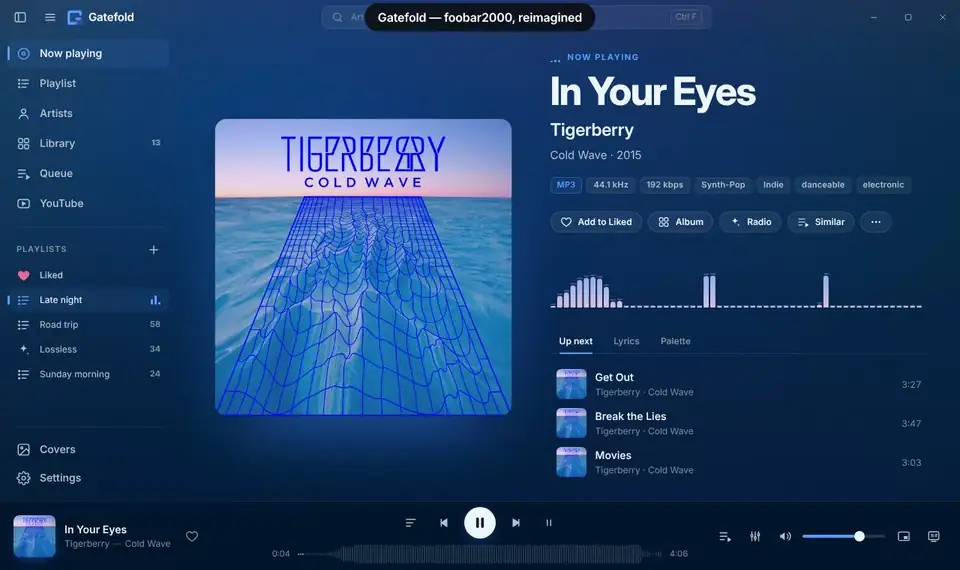
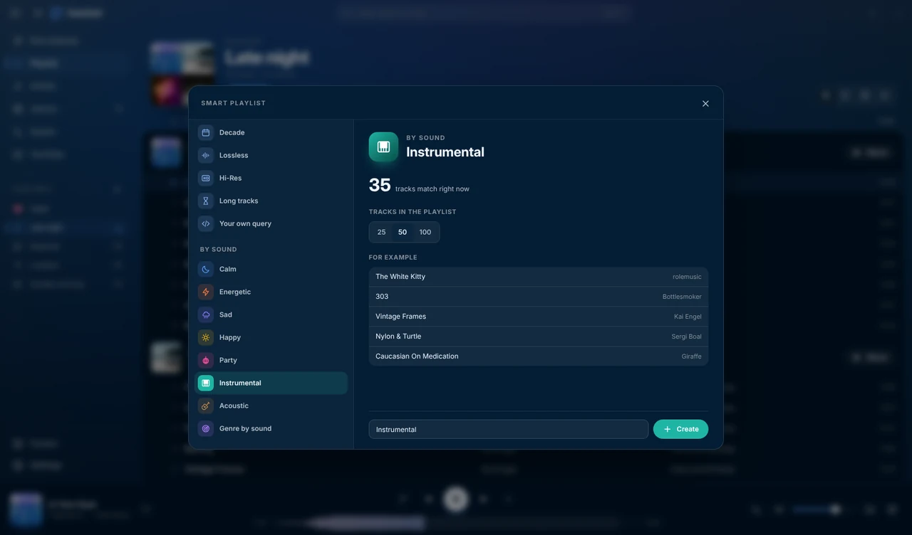
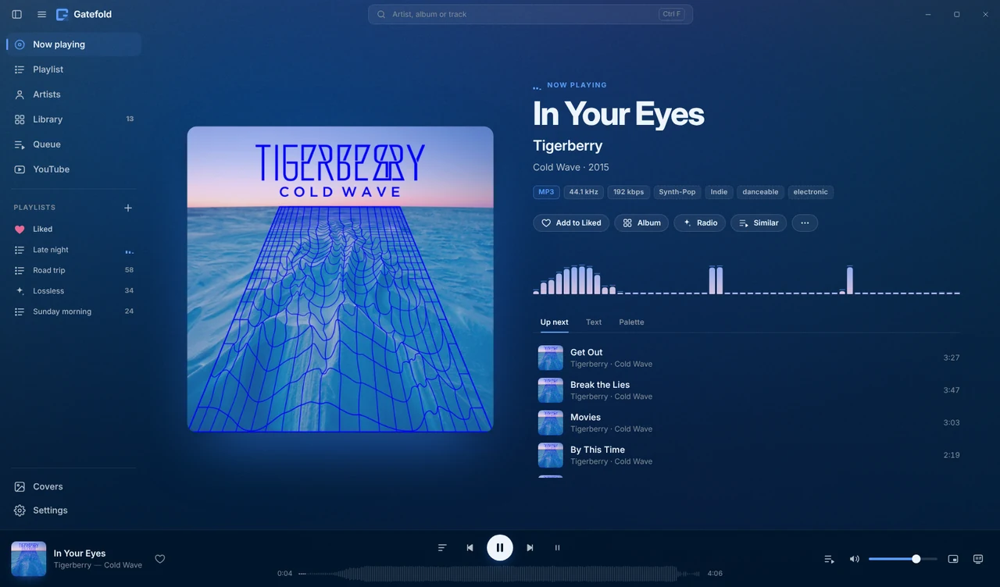
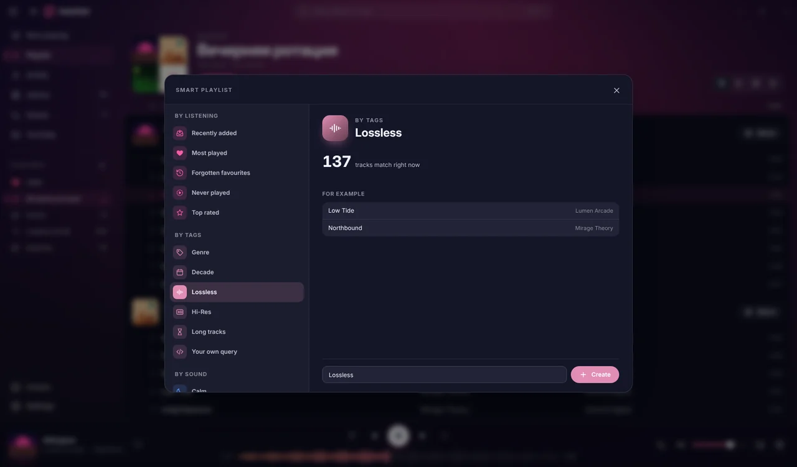
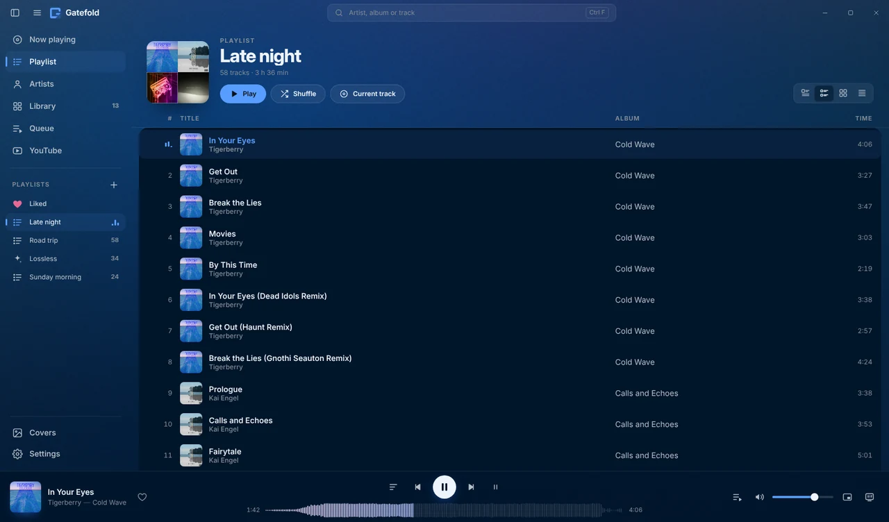
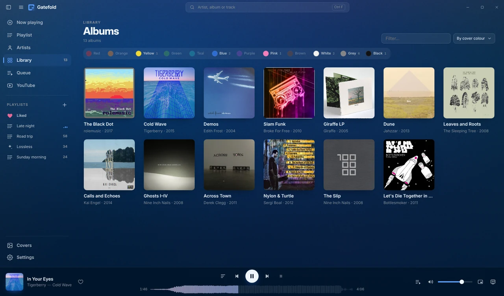
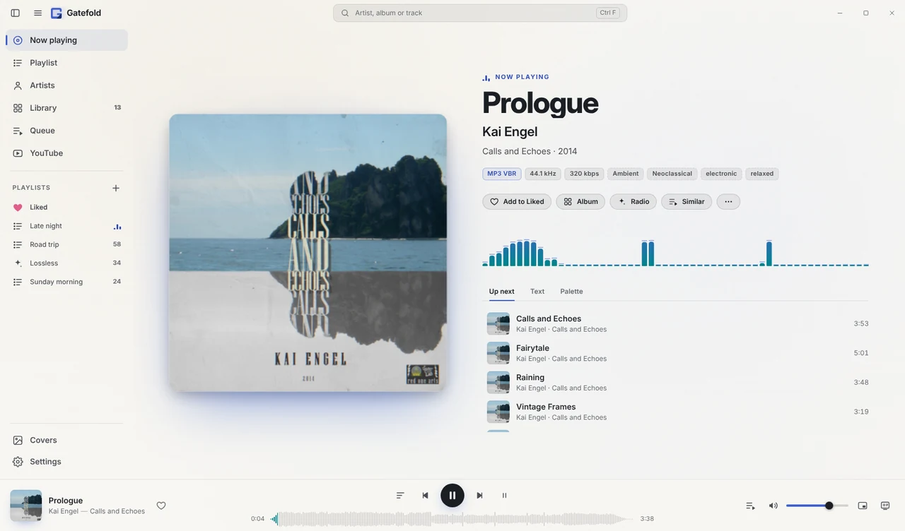

<h1 align="center">Gatefold</h1>

<b>foobar2000 that understands your music.</b> 
Radio and mood playlists that go by how your songs <i>sound</i> — for your own files, on your own PC. No server, no subscription, nothing to configure. 
<a href="../../releases/latest"><b>Download the installer</b></a> · <a href="README.ru.md">Русская версия</a>

Gatefold is a modern interface for [foobar2000](https://www.foobar2000.org), the audiophile's music player for Windows, built on the [foo_ui_webview2](https://github.com/NereaFantasia/foo_ui_webview2) component. You keep foobar2000's playback engine and every component you use; you gain a player that knows which of your songs belong together.

## Why Gatefold

- **Radio and playlists that listen.** An optional neural network (Discogs-EffNet) listens to each track of your library once, on your computer. Then a radio from any song stays in its mood, **Similar tracks** finds the songs that sound closest, and smart playlists offer moods — calm, energetic, sad, happy, party, acoustic, and instrumental that means *no voice at all*. Streaming services and Plexamp do this for their catalogues or with a media server and a subscription; Gatefold does it for the files on your disk, free, and nothing is uploaded.
- **foobar2000 underneath.** Gapless playback, every format, ReplayGain, DSP, WASAPI exclusive output, foobar2000's own context menus and all your components keep working. Output, ReplayGain, DSP and the whole Advanced tree are in Gatefold's settings.
- **Nothing to set up.** One installer brings foobar2000 (if you don't have it), the component, the WebView2 Runtime and the theme, and foobar2000 opens in Gatefold. No fonts to install, no layouts to import, no scripts to edit. Updates install in one click and can be rolled back.
- **Smart playlists without the query language.** Recently added, most played, forgotten favourites, never played, a genre, a decade, lossless, hi-res, long tracks — pick one, see how many tracks match and a few of them, create. They are real foobar2000 autoplaylists and keep themselves up to date.
- **A library that looks after itself.** Missing covers are found (iTunes · Deezer · MusicBrainz/Cover Art Archive), low-resolution ones are replaced (with a backup), synced lyrics come from your tags, `.lrc` files or LRCLIB, and genres come from MusicBrainz — even for files with no genre tag.
- **Private by design.** No account, no telemetry; every network request belongs to a feature you can see and switch off ([Privacy](#privacy)).

| Playlists by how the music sounds | Radio, Similar, genre and mood of the track |
|---|---|
|  |  |
| **Smart playlists without queries** | **Playlist with covers** |
|  |  |
| **Library by cover colour** | **Fixed light theme** |
|  |  |

The screenshots and the demo show real albums released under Creative Commons licences, analysed by Gatefold itself.

- Nine Inch Nails — *The Slip* · [CC BY-NC-SA 3.0 US](https://creativecommons.org/licenses/by-nc-sa/3.0/us/) · [Internet Archive](https://archive.org/details/nine_inch_nails_the_slip)
- Nine Inch Nails — *Ghosts I–IV* · [CC BY-NC-SA 3.0 US](https://creativecommons.org/licenses/by-nc-sa/3.0/us/) · [Internet Archive](https://archive.org/details/nineinchnails_ghosts_I_IV)
- Kai Engel — *Calls and Echoes* · [CC BY-NC-SA 4.0](https://creativecommons.org/licenses/by-nc-sa/4.0/) · [Internet Archive](https://archive.org/details/SCL115)
- Broke For Free — *Slam Funk* · [CC BY 3.0](https://creativecommons.org/licenses/by/3.0/) · [Internet Archive](https://archive.org/details/Slam_Funk-7603)
- Derek Clegg — *Across Town* · [CC BY-NC 3.0 US](https://creativecommons.org/licenses/by-nc/3.0/us/) · [Internet Archive](https://archive.org/details/diymAR06)
- Tigerberry — *Cold Wave* · [CC BY-NC-SA 4.0](https://creativecommons.org/licenses/by-nc-sa/4.0/) · [Internet Archive](https://archive.org/details/SCL160)
- rolemusic — *The Black Dot* · [CC BY 4.0](https://creativecommons.org/licenses/by/4.0/) · [Internet Archive](https://archive.org/details/TheBlackDot)
- Edith Frost — *Demos* · [CC BY-NC 1.0](https://creativecommons.org/licenses/by-nc/1.0/) · [Internet Archive](https://archive.org/details/csr027)
- Giraffe — *Giraffe LP* · [CC BY-NC-SA 2.5](https://creativecommons.org/licenses/by-nc-sa/2.5/) · [Internet Archive](https://archive.org/details/12rec.026)
- Sergi Boal — *Nylon & Turtle* · [CC BY-NC-SA 4.0](https://creativecommons.org/licenses/by-nc-sa/4.0/) · [Internet Archive](https://archive.org/details/NS051)
- Bottlesmoker — *Let's Die Together in 2012* · [CC BY-NC-SA 3.0](https://creativecommons.org/licenses/by-nc-sa/3.0/) · [Internet Archive](https://archive.org/details/hujan018)
- Jahzzar — *Dune* · [CC BY-SA 3.0](https://creativecommons.org/licenses/by-sa/3.0/) · [Internet Archive](https://archive.org/details/Dune-13188)
- The Sleeping Tree — *Leaves and Roots* · [CC BY-NC-SA 3.0 DE](https://creativecommons.org/licenses/by-nc-sa/3.0/de/) · [Internet Archive](https://archive.org/details/12rec.054)

Covers and titles belong to their authors and are shown under these licences. The genres, moods and playlists in the pictures are what Gatefold's sound analysis made of these recordings (`tools/showcase/`).

## Everything else

- **Playlists in four views** (by album, with covers, tiles, compact) with real editing: Shift/Ctrl selection, drag to reorder or onto a sidebar playlist, Delete, Ctrl+Z (foobar2000's own undo), Alt+↑/↓.
- **Your own columns** in playlists and on album pages, written in foobar2000's title formatting like Default UI's custom columns (%performer%, %genre%, your own tags…), with a live preview. Song, artist and album in a playlist are links.
- **Library and Artists** — cover grids or your folders, album pages, artist photos; albums split by guest artists are merged back, two editions of one album (a 2014 release and its 2016 Deluxe reissue) are two albums, and «A; B» or a multi-value tag lists an album under each artist; the library can be sorted and filtered by cover colour.
- **Covers your way** — from your computer, the clipboard, the album's folder or tags, or the web; kept only in Gatefold, embedded in the tags or saved next to the tracks under your own name; or found for the whole library by a path rule (`D:\Covers\%album artist% - %album%`). A cover you chose is never replaced, and LP-shaped sleeves are shown whole.
- **Now playing** — a large cover, a spectrum, format badges (codec, bit depth / sample rate, bitrate, DR, ReplayGain, play count), the track's genres and mood, synced lyrics and up next. The interface takes its colours from the cover (an album can have colours of your choice), or keeps a fixed Dark, Light or Grey theme, or your own.
- **Sound** — DSP presets and the chain playing now, one click from the player bar, with foobar2000's equalizer and DSP Manager a click away.
- **Volume levelling** — one switch in Settings: albums play equally loud while each keeps its own quiet and loud moments (or per track, or «smart»), at −18, −16, −14 or −23 LUFS. Tracks without ReplayGain values are measured in the background like the ReplayGain 2.0 scanner does (EBU R128, true peak, whole albums at once) and get the standard tags; foobar2000 applies them, gapless, with clipping prevention.
- **Canvas** — full-screen Now playing, also on a second monitor, with optional MilkDrop visuals; a **mini player** above other windows; taskbar buttons and progress; an optional tray icon.
- **«More like this» radio** without sound analysis too: artists related to the seed that you actually have.
- **Liked** — a heart in the player and on every row, kept in an ordinary foobar2000 playlist.
- **YouTube** — paste a link, or search with your own YouTube Data API key. Subtitles on or off with one button, in the language you pick.
- **English, Russian, German, Spanish and Chinese (Simplified)**, picked from Windows or set in Settings.
- **Fun mode** (hidden — click the “Gatefold” title ten times): three interface styles and 45 achievements.

The sound models (~30 MB, CC BY-NC-SA 4.0, non-commercial) are downloaded only when you turn sound analysis on in Settings → Sound analysis (AI); it runs in the background at the speed you choose.

## Requirements

| | |
|---|---|
| Windows | 10 or 11, 64-bit |
| foobar2000 | 2.x, 64-bit |
| [foo_ui_webview2](https://github.com/NereaFantasia/foo_ui_webview2) | 2.0 or later |
| WebView2 Runtime | Preinstalled on Windows 11 and on most Windows 10 machines |
| Optional | `foo_playcount` (play statistics, “recently played” sorting), `foo_dr_meter` (DR badge) |

## Installation

### With the installer (recommended)
Download `Gatefold-Setup.exe` from [Releases](../../releases) and run it. It installs or updates foobar2000, foo_ui_webview2 and the WebView2 Runtime when needed, puts the theme in place, adds Gatefold shortcuts and makes Webview2 UI foobar2000's interface — foobar2000 opens straight in Gatefold (its configuration is backed up as `config.sqlite.before-gatefold`; to go back, choose *Default User Interface* in Preferences → Display).

### Manually
1. Install **foo_ui_webview2**. Open the `.fb2k-component` file, confirm in foobar2000, then restart foobar2000.
2. Go to **File → Preferences → Display → WebView2 UI** → **Manage… → Create…** and name the template `gatefold`. Press **Open…**.
3. Copy the **contents** of the release archive into that folder, so that `index.html` sits directly inside it.
4. Under **Preferences → Display**, choose **Webview2 UI** as the user interface, pick `gatefold` as the **Template**, then press **Apply**.

To go back, choose *Default User Interface* again. Your old layout is kept.

### Updating
When a new release is out, an **Update available** button appears at the bottom of the sidebar (and in **Settings → Updates**). One click shows what changed and installs it: the theme archive is downloaded from this repository's Releases, checked against `SHA256SUMS.txt`, the current version is backed up to `%profile%\gatefold\backup\<version>`, and the interface reloads. **Restore previous version** in Settings puts the backup back. If a release needs a newer foo_ui_webview2, the button offers the installer instead, which updates everything. Checking can be turned off; nothing is installed without your click.

## Privacy

Gatefold has **no telemetry** and no accounts. The only network requests it makes are the ones its features need, and every one goes through foobar2000:

| Feature | Goes to | When |
|---|---|---|
| Cover art | iTunes Search API, Deezer API, MusicBrainz / Cover Art Archive | Albums without art (automatic search can be turned off) |
| Artist photos | Deezer, MusicBrainz / Wikidata | The Artists screen (can be turned off) |
| «More like this» radio | Deezer (related artists and their best-known songs, by name), MusicBrainz (the artist's id), ListenBrainz (artists listened to together, by that id) | Only when you start a radio; answers are kept for two weeks |
| Lyrics | LRCLIB | Tracks without lyrics in tags or files |
| YouTube | youtube-nocookie.com player; Google API when you use your own key | Only on the YouTube screen |
| Update check | api.github.com, github.com (release downloads) | Every 12 hours and when you press *Check now* (can be turned off) |
| Sound analysis (AI) | raw.githubusercontent.com (this repository's `ml-assets` branch) | Once, when you turn the feature on; then a manifest check at most weekly. The analysis itself never leaves your computer |
| Genres (with sound analysis on) | musicbrainz.org (artist name; then that artist's albums) | Once per artist, about one request a second in the background (can be turned off) |

Everything downloaded is kept on your computer: in the theme's cache, or next to your music if you choose to save covers or lyrics there.

### Optional unofficial sources — off by default
Settings can turn on lyrics from **Musixmatch, NetEase, QQ Music and Kugou**, and a **YouTube search that reads the results page** without a key. These use the services' private interfaces without their approval. They may break at any time, and using them may go against those services' terms. They are disabled until you turn them on yourself. Lyrics and cover art are copyrighted and are for personal use only.

## Code signing policy

Free code signing provided by [SignPath.io](https://about.signpath.io/), certificate by [SignPath Foundation](https://signpath.org/).

*Status: applied for. Until the application is approved, release installers are unsigned, and Windows SmartScreen may warn on first run (More info → Run anyway). Every release lists the SHA-256 of its files in `SHA256SUMS.txt`.*

- Committers and reviewers: the members of this repository. Approvers: the repository owner.
- Every signed release is built by GitHub Actions from this repository (`.github/workflows/release.yml`) and approved by hand before signing.
- Privacy: this program does not transfer any information to other networked systems unless specifically requested by the user or the person installing or operating it — see [Privacy](#privacy) for every request a feature makes.

## Keyboard shortcuts

| Keys | Action |
|---|---|
| Space | Play / pause |
| ← / → | Seek ±5 s (Ctrl: ±30 s) |
| Shift + ← / → | Previous / next track |
| ↑ / ↓ | Volume ±5 |
| M | Mute |
| L | Like / unlike |
| Ctrl+F | Search |
| Alt+1…8 | Now playing / Playlist / Artists / Library / Queue / Covers / Settings / YouTube |
| Alt+← / Alt+→, mouse buttons 4/5 | Back / forward |
| F11 | Full screen |
| F (on Now playing) | Canvas |
| Ctrl+R | Reload the interface |
| Ctrl+P | foobar2000 Preferences |

In a playlist: Shift/Ctrl+click select · Ctrl+A all · Delete remove · Ctrl+Z / Ctrl+Y undo / redo · Alt+↑/↓ move · Enter play · Esc clear the selection.

On the YouTube screen: Space/K play/pause · J/L ±10 s · F full screen · T theatre mode · Q quality · C subtitles · N/P next/previous · `/` search.

## Troubleshooting

- **foobar2000 opens in its old interface** — choose **Webview2 UI** in Preferences → Display (the installer does this itself; this is for manual installs, or when its backup step could not run).
- **A white or test page** — the template isn't selected, or `index.html` isn't directly inside the template folder.
- **Covers aren't downloaded** — open the Covers screen and check *Last error*. View → Console shows `[Gatefold]` lines. A read-only music folder has nowhere to save covers.
- **Odd window behaviour** — Settings → Window and startup → turn off *Custom window frame*, then press Ctrl+R.
- **Debugging** — Preferences → WebView2 UI → enable DevTools, then press F12.

When you report a problem, please include your foobar2000 and foo_ui_webview2 versions and the `[Gatefold]` lines from the console.

## Building from source

See [docs/RELEASING.md](docs/RELEASING.md) — the theme needs no build step; the installer is built by GitHub Actions (Inno Setup 6.6) from `installer/gatefold.iss`, with every bundled file downloaded from its official source and checksummed.

## Translating

Strings are written in Russian in the source and wrapped in `$t('…')`. Each language is a file in `js/locales/` that maps those Russian strings to translations, gettext-style. Plurals are `'one|other'` entries (CLDR rules via `Intl.PluralRules`). Static markup in `index.html` is translated at start-up. To add a language, copy `js/locales/en.js`, translate the values, and register the language in `js/i18n.js`.

## License

[MIT](LICENSE) © Gatefold contributors. Third-party fonts and components keep their own licenses — see [THIRD_PARTY_NOTICES.md](THIRD_PARTY_NOTICES.md).
foobar2000 is freeware by Peter Pawłowski. Gatefold is an independent project, not affiliated with or endorsed by foobar2000 or by the author of foo_ui_webview2.
