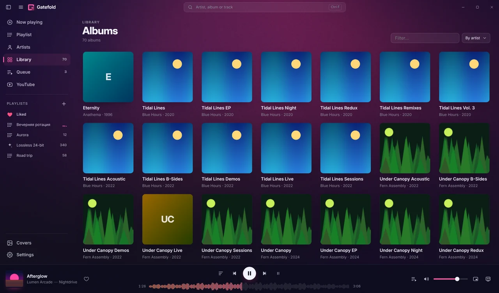
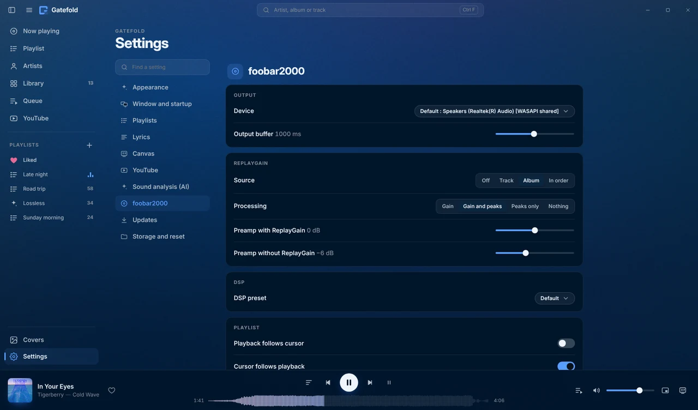

# Gatefold

**A modern interface for foobar2000 that takes its colours from your music.**
[Русская версия →](README.ru.md)

Gatefold is a theme for the [foo_ui_webview2](https://github.com/NereaFantasia/foo_ui_webview2) component. It replaces foobar2000's interface with a full-window player. The palette is built live from the cover art of the playing album, and the theme covers the whole player: library, artists, playlists, synced lyrics, a full-screen “Canvas” mode, YouTube, and automatic cover art.

| Playlist with covers | Library |
|---|---|
|  |  |
| **Settings** | **Fixed light theme** |
|  |  |

Screenshots use placeholder artwork from the test fixtures, not real album covers.

## Features

- **Album-driven colour.** k-means in OKLab picks the colour roles from each cover, with WCAG contrast control. Or choose a fixed **Dark**, **Light** or **Grey** theme.
- **Now playing:** a large cover that breathes with the bass and a spectrum in the album's colours. Format badges show codec, bit depth / sample rate, bitrate, DR, ReplayGain and play count.
- **Playlists in four views:** by album, with covers, tiles and compact. Each playlist remembers its own view.
- **Real playlist editing:** select with Shift/Ctrl, drag to reorder or onto a playlist in the sidebar, Delete, Ctrl+Z (foobar2000's own undo), Alt+↑/↓; drag playlists to reorder them.
- **Smart playlists without the query language:** recently added, most played, forgotten favourites, never played, a genre, a decade, lossless, hi-res… with a live count of matching tracks. They stay up to date by themselves.
- **«More like this» radio:** similar artists you actually have (Deezer's related artists, plus genre and era), never the same artist twice in a row; the playlist keeps topping itself up.
- **Liked** — a heart in the player and on every row. Likes are stored in an ordinary foobar2000 playlist.
- **Library and Artists:** cover grids, sorting by recently added or played, and album pages. Albums split by guest artists are merged back into one.
- **The colour wall:** sort the library by cover colour — a rainbow of your albums — and pick a colour to see only those covers.
- **Windows around the window:** ⏮ ⏯ ⏭ ♡ on the taskbar thumbnail, progress on the taskbar button, an optional tray icon with a player menu (minimize / close to tray), and a **mini player** that stays above other windows.
- **Synced lyrics:** from tags or an `.lrc` next to the track, then online (LRCLIB). Lines are highlighted as they play, click a line to seek, and `[` `]` adjust the timing.
- **Canvas:** full-screen Now playing with slow motion, lyrics and a clock. It can open on a second monitor.
- **YouTube:** paste a link, or search with your own YouTube Data API key. The player has its own controls, quality selection, a queue, history and a mini player. Music pauses while a video plays.
- **Cover art:** finds missing covers (iTunes · Deezer · MusicBrainz/CAA), checks the quality of the covers you have, and replaces weak ones (with backups).
- **Your foobar2000 stays yours:** right-click opens the native context menu, ☰ opens the full main menu, and all your components still work.
- **English and Russian** — picked from Windows, or set in Settings → Window and startup → Language.
- **Fun mode** (hidden — click the “Gatefold” title ten times): three complete interface styles and 45 achievements.

## Requirements

| | |
|---|---|
| Windows | 10 or 11, 64-bit |
| foobar2000 | 2.x, 64-bit |
| [foo_ui_webview2](https://github.com/NereaFantasia/foo_ui_webview2) | 2.0 or later |
| WebView2 Runtime | Preinstalled on Windows 11 and on most Windows 10 machines |
| Optional | `foo_playcount` (play statistics, “recently played” sorting), `foo_dr_meter` (DR badge) |

## Installation

### With the installer (recommended)
Download `Gatefold-Setup.exe` from [Releases](../../releases) and run it. It installs or updates foobar2000, foo_ui_webview2 and the WebView2 Runtime when needed, puts the theme in place and tells you about the one remaining click (see below).

### Manually
1. Install **foo_ui_webview2**. Open the `.fb2k-component` file, confirm in foobar2000, then restart foobar2000.
2. Go to **File → Preferences → Display → WebView2 UI** → **Manage… → Create…** and name the template `gatefold`. Press **Open…**.
3. Copy the **contents** of the release archive into that folder, so that `index.html` sits directly inside it.
4. Under **Preferences → Display**, choose **Webview2 UI** as the user interface, pick `gatefold` as the **Template**, then press **Apply**.

To go back, choose *Default User Interface* again. Your old layout is kept.

### Updating
When a new release is out, an **Update available** button appears at the bottom of the sidebar (and in **Settings → Updates**). One click shows what changed and installs it: the theme archive is downloaded from this repository's Releases, checked against `SHA256SUMS.txt`, the current version is backed up to `%profile%\gatefold\backup\<version>`, and the interface reloads. **Restore previous version** in Settings puts the backup back. If a release needs a newer foo_ui_webview2, the button offers the installer instead, which updates everything. Checking can be turned off; nothing is installed without your click.

## Privacy

Gatefold has **no telemetry** and no accounts. The only network requests it makes are the ones its features need, and every one goes through foobar2000:

| Feature | Goes to | When |
|---|---|---|
| Cover art | iTunes Search API, Deezer API, MusicBrainz / Cover Art Archive | Albums without art (automatic search can be turned off) |
| Artist photos | Deezer, MusicBrainz / Wikidata | The Artists screen (can be turned off) |
| «More like this» radio | Deezer (related artists, by name) | Only when you start a radio |
| Lyrics | LRCLIB | Tracks without lyrics in tags or files |
| YouTube | youtube-nocookie.com player; Google API when you use your own key | Only on the YouTube screen |
| Update check | api.github.com, github.com (release downloads) | Every 12 hours and when you press *Check now* (can be turned off) |

Everything downloaded is kept on your computer: in the theme's cache, or next to your music if you choose to save covers or lyrics there.

### Optional unofficial sources — off by default
Settings can turn on lyrics from **Musixmatch, NetEase, QQ Music and Kugou**, and a **YouTube search that reads the results page** without a key. These use the services' private interfaces without their approval. They may break at any time, and using them may go against those services' terms. They are disabled until you turn them on yourself. Lyrics and cover art are copyrighted and are for personal use only.

## Keyboard shortcuts

| Keys | Action |
|---|---|
| Space | Play / pause |
| ← / → | Seek ±5 s (Ctrl: ±30 s) |
| Shift + ← / → | Previous / next track |
| ↑ / ↓ | Volume ±5 |
| M | Mute |
| L | Like / unlike |
| Ctrl+F | Search |
| Alt+1…8 | Now playing / Playlist / Artists / Library / Queue / Covers / Settings / YouTube |
| Alt+← / Alt+→, mouse buttons 4/5 | Back / forward |
| F11 | Full screen |
| F (on Now playing) | Canvas |
| Ctrl+R | Reload the interface |
| Ctrl+P | foobar2000 Preferences |

In a playlist: Shift/Ctrl+click select · Ctrl+A all · Delete remove · Ctrl+Z / Ctrl+Y undo / redo · Alt+↑/↓ move · Enter play · Esc clear the selection.

On the YouTube screen: Space/K play/pause · J/L ±10 s · F full screen · T theatre mode · Q quality · N/P next/previous · `/` search.

## Troubleshooting

- **A white or test page** — the `gatefold` template isn't selected, or `index.html` isn't directly inside the template folder.
- **Covers aren't downloaded** — open the Covers screen and check *Last error*. View → Console shows `[Gatefold]` lines. A read-only music folder has nowhere to save covers.
- **Odd window behaviour** — Settings → Window and startup → turn off *Custom window frame*, then press Ctrl+R.
- **Debugging** — Preferences → WebView2 UI → enable DevTools, then press F12.

When you report a problem, please include your foobar2000 and foo_ui_webview2 versions and the `[Gatefold]` lines from the console.

## Building from source

See [docs/RELEASING.md](docs/RELEASING.md) — the theme needs no build step; the installer is built by GitHub Actions (Inno Setup 6.6) from `installer/gatefold.iss`, with every bundled file downloaded from its official source and checksummed.

## Translating

Strings are written in Russian in the source and wrapped in `$t('…')`. Each language is a file in `js/locales/` that maps those Russian strings to translations, gettext-style. Plurals are `'one|other'` entries (CLDR rules via `Intl.PluralRules`). Static markup in `index.html` is translated at start-up. To add a language, copy `js/locales/en.js`, translate the values, and register the language in `js/i18n.js`.

## License

[MIT](LICENSE) © Gatefold contributors. Third-party fonts and components keep their own licenses — see [THIRD_PARTY_NOTICES.md](THIRD_PARTY_NOTICES.md).
foobar2000 is freeware by Peter Pawłowski. Gatefold is an independent project, not affiliated with or endorsed by foobar2000 or by the author of foo_ui_webview2.
