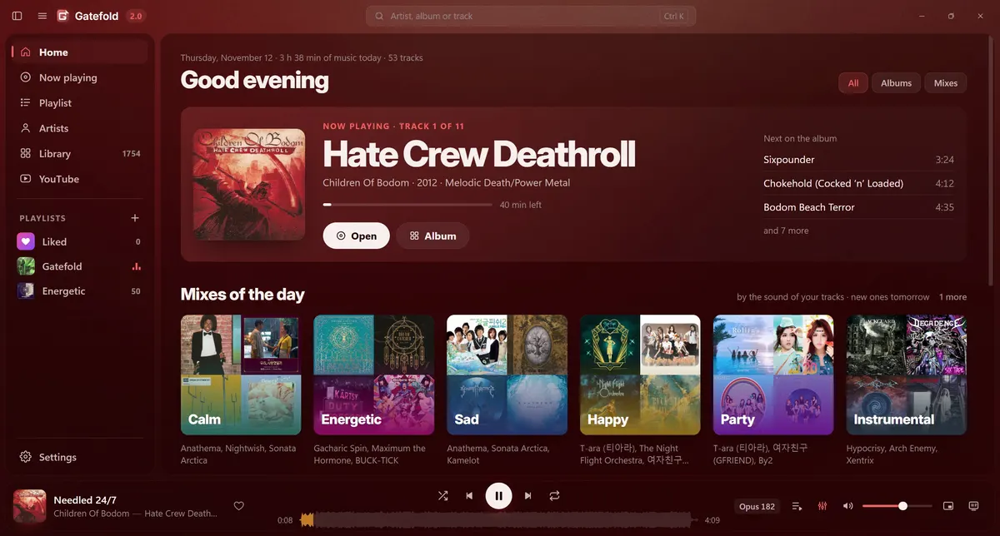
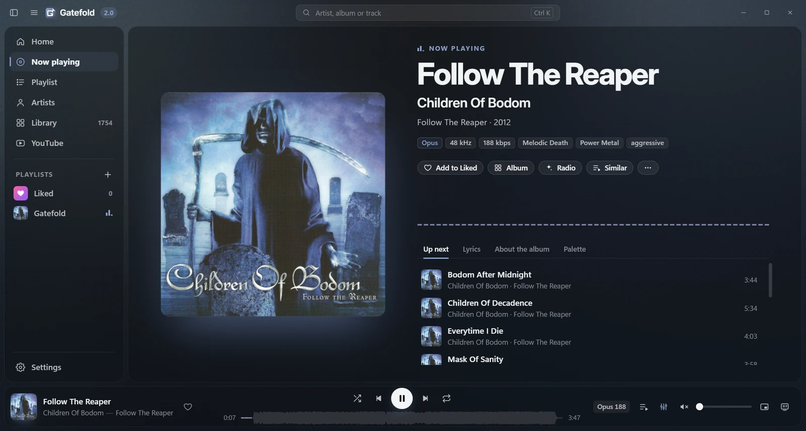
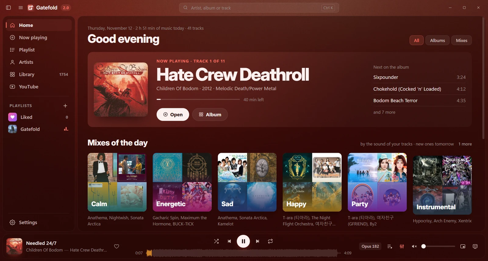
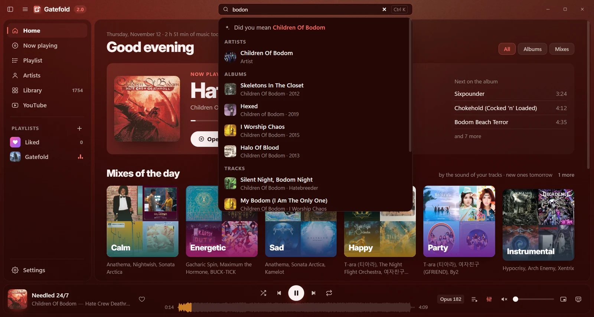
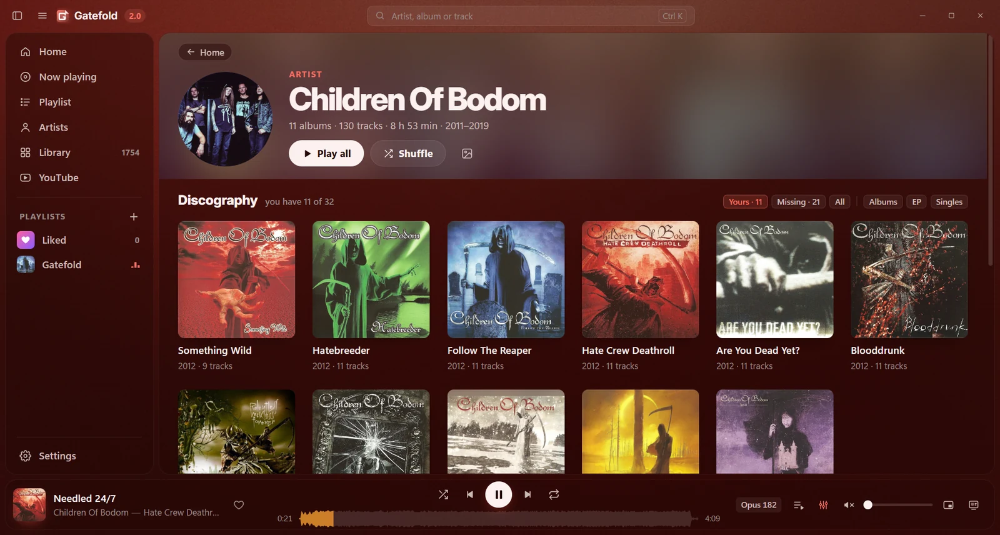
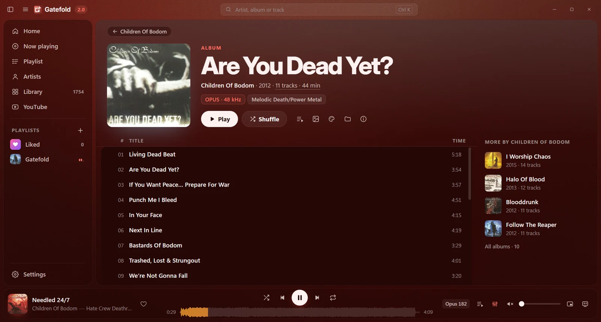
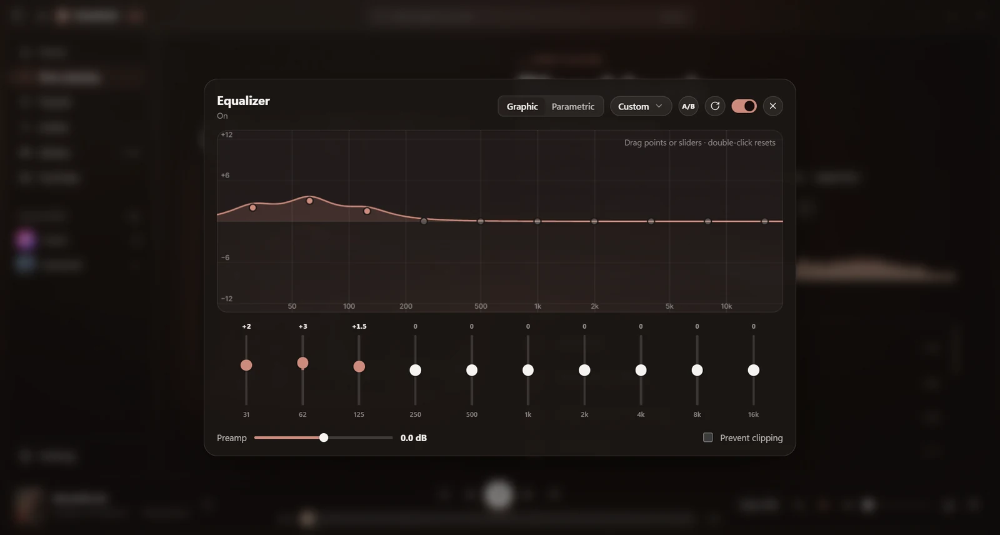
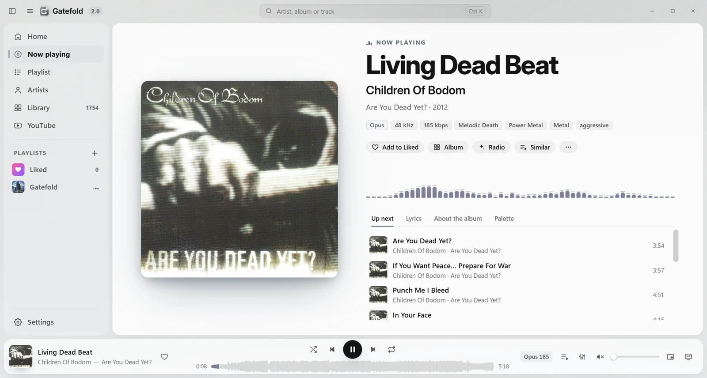
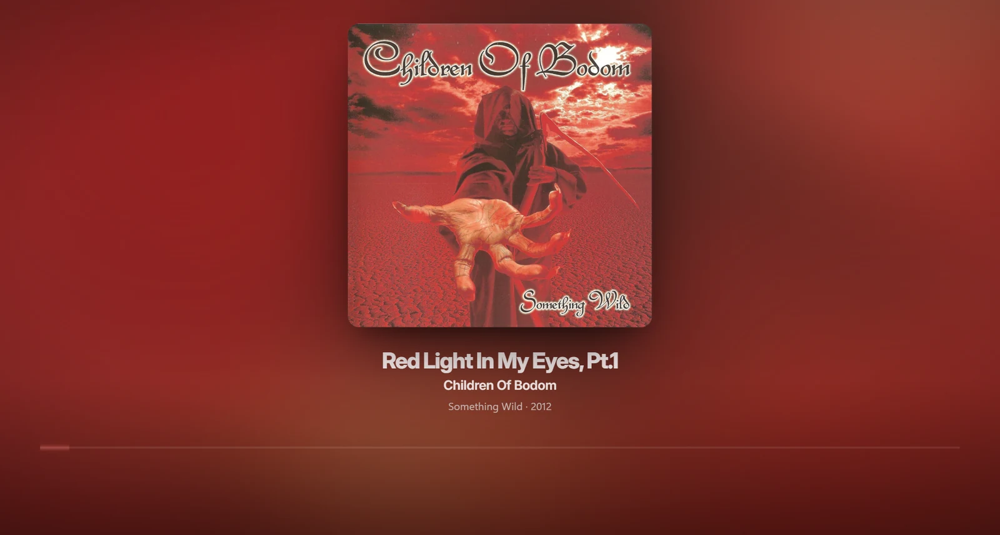

  

<h1 align="center">Gatefold</h1>

A modern interface for foobar2000 that takes on the colours of the album you're playing.

  
  
  
  
  

  

  <a href="#-highlights">Highlights</a> · <a href="#-install">Install</a> · <a href="#-faq">FAQ</a> · <a href="README.ru.md">Читать по-русски</a>

 

  

▶ Click for the full video

## ✨ Highlights

- Native foobar2000 component
- The interface takes on the colours of the playing album
- Full artist discographies
- Any album playable via YouTube
- Smart search that forgives typos
- Built-in graphic and parametric equalizer
- Volume levelling to EBU R128
- Synced lyrics
- Mixes of the day by how your music sounds
- Smart playlists without a query language
- Listening history and «Your year in music»
- Dark and light themes
- Full screen, mini player, tray and taskbar controls
- English, Русский, Deutsch, Español, 中文
- Opens in under a second, light on CPU
- Free, no account, no telemetry

## 🖼 Screenshots

<table>
<tr>
<td width="50%">
<b>Now playing</b>
</td>
<td width="50%">
<b>Home</b>
</td>
</tr>
<tr>
<td width="50%">
<b>Search</b>
</td>
<td width="50%">
<b>Artist</b>
</td>
</tr>
<tr>
<td width="50%">
<b>Album</b>
</td>
<td width="50%">
<b>Equalizer</b>
</td>
</tr>
<tr>
<td width="50%">
<b>Light theme</b>
</td>
<td width="50%">
<b>Full screen</b>
</td>
</tr>
</table>

## 📥 Install

1. Download the `foo_gatefold` `.fb2k-component` file from the [latest release](../../releases/latest).
2. Open it: foobar2000 installs it and restarts.
3. Choose **Gatefold** when foobar2000 offers the new interface.

**On Gatefold 1.x:** press **Update now** in Gatefold, then **Install Gatefold 2.0**.

<b>Requirements</b>

| | |
|---|---|
| Windows | 10 or 11, 64-bit |
| foobar2000 | 2.x, 64-bit |
| WebView2 Runtime | built into Windows 11; Windows 10 gets it from Microsoft Edge |
| Optional | `foo_playcount` (play statistics), `foo_dr_meter` (DR badge) |

<b>Privacy</b>: no telemetry, no account

Every network request belongs to a feature you can see and switch off, and all of them go through foobar2000.

| Feature | Goes to | When |
|---|---|---|
| Cover art | iTunes, Deezer, MusicBrainz / Cover Art Archive | Albums without art (can be turned off) |
| Artist photos and biographies | Deezer, MusicBrainz, Wikidata, Wikipedia | The Artists screen (can be turned off) |
| Discographies | MusicBrainz, then Deezer and Apple Music if needed | An artist's page (can be turned off) |
| Radio and «Similar» | Deezer, MusicBrainz, ListenBrainz | Only when you start one |
| Lyrics | LRCLIB | Tracks without lyrics in tags or files |
| YouTube | youtube-nocookie.com | Only on the YouTube screen |
| Updates | api.github.com, github.com | Every 12 hours (can be turned off) |
| Sound analysis | this repository | Once, when you turn it on. The analysis itself never leaves your PC |

**Optional unofficial sources, off by default:** lyrics from Musixmatch, NetEase, QQ Music and Kugou, and a keyless YouTube search. They use private interfaces, may break at any time and may go against those services' terms. Lyrics and covers are for personal use only.

<b>Keyboard shortcuts</b>

| Keys | Action |
|---|---|
| Space | Play / pause |
| ← / → | Seek ±5 s (Ctrl: ±30 s) |
| Shift + ← / → | Previous / next track |
| ↑ / ↓ · M | Volume ±5 · mute |
| Ctrl+K | Search everything: screens, commands, albums, artists, tracks |
| L | Like |
| Alt+1…8 | Switch screens |
| F11 · F | Full screen · Canvas |
| Ctrl+P | foobar2000 Preferences |

In lists: Shift/Ctrl+click, Ctrl+A, Delete, Ctrl+Z / Ctrl+Y, Alt+↑/↓, Enter, Esc.

## ❓ FAQ

<b>Does it change how my music sounds?</b>

No. Playback is foobar2000's own; the equalizer and levelling are off until you turn them on.

<b>Will my playlists and components survive?</b>

Yes. Gatefold is one more interface module; switch back to Default UI or Columns UI any time.

<b>Do I still need foo_ui_webview2?</b>

No.

<b>Is it free? Is it open source?</b>

Free. Not open source since 2.0: see [License](#-license).

## 📄 License

Gatefold 2.0 is **free to use but not open source**: © 2026 DEVIROYrus, all rights reserved, under the [Gatefold End-User License Agreement](EULA.md) ([in Russian](EULA.ru.md)). You may install and use it and share the unchanged official package. You may not modify it, reuse its code or design, or sell it. Gatefold 1.x, the source in this repository, remains under the [MIT License](LICENSE). Third-party components keep their own licenses ([THIRD_PARTY_NOTICES.md](THIRD_PARTY_NOTICES.md)).

foobar2000 is freeware by Peter Pawłowski. Gatefold is an independent project, not affiliated with foobar2000. Album covers in the screenshots belong to their respective owners.

  Made for people who still have a music library.

