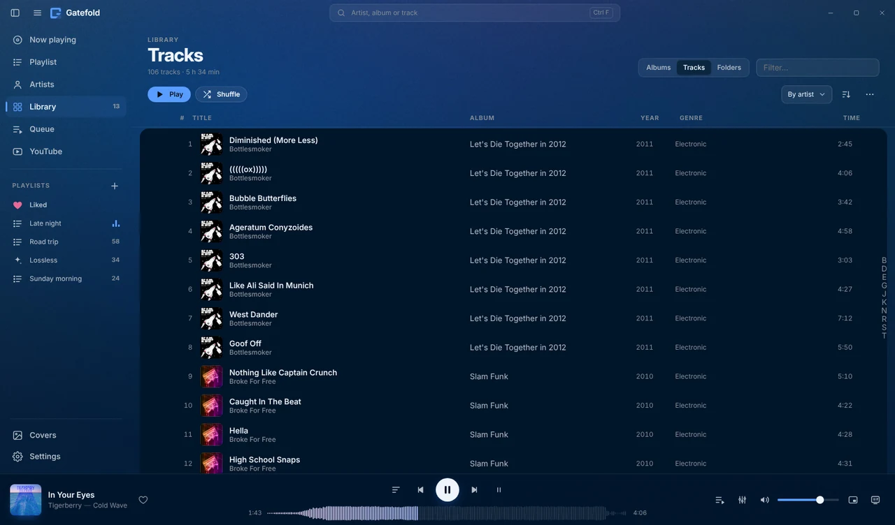
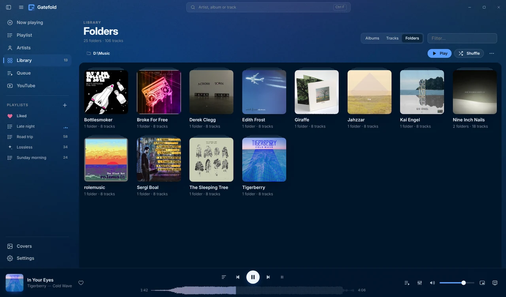

<h1 align="center">Gatefold</h1>

<b>foobar2000 в новом облике.</b> 
Современный интерфейс вокруг обложек ваших альбомов, который берёт цвета у того, что сейчас играет, а внутри — звук и скорость foobar2000.

  
  
  
  

  

Бесплатно · один установщик · Русский, English, Deutsch, Español, 中文 · <a href="README.md">Read in English</a>

## Почему Gatefold

- 🎨 **Каждый экран в цветах вашей музыки.** Обложки заполняют окно, а весь интерфейс берёт цвета у играющего альбома.
- 🎧 **От foobar2000 ничего не теряется.** Gapless, любые форматы, ReplayGain, DSP, WASAPI и все ваши компоненты работают как раньше.
- 🧠 **Он знает, как звучат ваши песни.** Анализ звука на вашем компьютере (по желанию) собирает радио, плейлисты по настроению и «Похожие треки» из ваших файлов. Ничего никуда не отправляется.
- ⚡ **Готово за минуту.** Один установщик ставит foobar2000, компонент и тему, а обновления ставятся в один клик.

## Как это выглядит

| | |
|:---:|:---:|
|  |  |
| **Сейчас играет** с синхронным текстом и очередью | **Альбомы** стеной обложек |
|  |  |
| **Треки**: все песни одним списком | **Папки**: медиатека как на диске |
|  |  |
| **Плейлисты по тому, как звучит музыка** | **Плейлисты**, которые можно по-настоящему править |

## Установка

1. **Скачайте** `Gatefold-Setup.exe` из [последнего релиза](../../releases/latest).
2. **Запустите.** Установщик сам поставит foobar2000 (если его нет), компонент [foo_ui_webview2](https://github.com/NereaFantasia/foo_ui_webview2) и WebView2 Runtime.
3. **Готово.** foobar2000 открывается сразу в Gatefold. Прежние настройки сохраняются в резервную копию, вернуться можно в Preferences → Display.

Когда выходит новая версия, в боковой панели появляется кнопка **«Доступно обновление»**. Обновление ставится в один клик, сверяется с `SHA256SUMS.txt`, и его можно откатить.

## Возможности

- **Сейчас играет:** большая обложка, значки формата (кодек, разрядность, DR, ReplayGain), синхронный текст из файлов или LRCLIB, очередь.
- **Медиатека:** альбомы, все треки или ваши папки. Издания одного альбома не смешиваются, «A; B» показывает альбом у каждого исполнителя, медиатеку можно сортировать по цвету обложек.
- **Умные плейлисты без языка запросов:** недавно добавленные, забытые любимцы, десятилетие, Hi-Res, настроение. Это настоящие автоплейлисты foobar2000.
- **Обложки следят за собой:** недостающие находятся, слабые заменяются, а выбранную вами обложку Gatefold не трогает.
- **Выравнивание громкости:** альбомы звучат одинаково громко и при этом сохраняют свою динамику. Работает по EBU R128 и на стандартных тегах ReplayGain.
- **Холст:** «Сейчас играет» на весь экран, в том числе на втором мониторе. Ещё есть мини-плеер, кнопки на панели задач, значок в трее, «Понравившиеся» и YouTube.

<b>Требования</b>

| | |
|---|---|
| Windows | 10 или 11, 64-бит |
| foobar2000 | 2.x, 64-бит (ставит установщик) |
| [foo_ui_webview2](https://github.com/NereaFantasia/foo_ui_webview2) | 2.0 или новее (ставит установщик) |
| По желанию | `foo_playcount` (статистика прослушиваний), `foo_dr_meter` (значок DR) |

<b>Установка вручную</b>

1. Установите **foo_ui_webview2**: откройте файл `.fb2k-component`, подтвердите, перезапустите foobar2000.
2. **Preferences → Display → WebView2 UI → Manage… → Create…**, имя `gatefold`, нажмите **Open…**.
3. Скопируйте туда **содержимое** `gatefold-theme-x.y.z.zip`, чтобы `index.html` лежал прямо в папке.
4. **Preferences → Display:** выберите **Webview2 UI**, шаблон `gatefold`, **Apply**.

<b>Конфиденциальность</b>: без телеметрии и аккаунтов

Каждый сетевой запрос относится к функции, которую видно и можно выключить, и все запросы идут через foobar2000.

| Функция | Куда | Когда |
|---|---|---|
| Обложки | iTunes, Deezer, MusicBrainz / Cover Art Archive | Альбомы без обложки (можно выключить) |
| Фото исполнителей | Deezer, MusicBrainz / Wikidata | Экран «Исполнители» (можно выключить) |
| Радио «Похожее» | Deezer, MusicBrainz, ListenBrainz | Только когда вы запускаете радио |
| Тексты | LRCLIB | Треки без текста в тегах или файлах |
| YouTube | youtube-nocookie.com; Google API с вашим ключом | Только на экране YouTube |
| Обновления | api.github.com, github.com | Раз в 12 часов (можно выключить) |
| Анализ звука | ветка `ml-assets` этого репозитория | Один раз при включении. Сам анализ не покидает компьютер |
| Жанры (с анализом звука) | musicbrainz.org | Один раз на исполнителя (можно выключить) |

**Неофициальные источники, по умолчанию выключены:** тексты из Musixmatch, NetEase, QQ Music и Kugou и поиск YouTube без ключа. Они используют закрытые интерфейсы, могут перестать работать в любой момент и могут нарушать условия этих сервисов. Тексты и обложки только для личного использования.

<b>Горячие клавиши</b>

| Клавиши | Действие |
|---|---|
| Пробел | Пауза / воспроизведение |
| ← / → | Перемотка ±5 с (Ctrl: ±30 с) |
| Shift + ← / → | Предыдущий / следующий трек |
| ↑ / ↓ · M | Громкость ±5 · без звука |
| L | Нравится |
| Ctrl+F | Поиск |
| Alt+1…8 | Переключение экранов |
| F11 · F | Весь экран · Холст |
| Ctrl+R · Ctrl+P | Перезагрузить интерфейс · настройки foobar2000 |

В списках: Shift/Ctrl+клик, Ctrl+A, Delete, Ctrl+Z / Ctrl+Y, Alt+↑/↓, Enter, Esc.

<b>Если что-то не так</b>

- **foobar2000 открывается в старом интерфейсе:** выберите **Webview2 UI** в Preferences → Display.
- **Белая страница:** не выбран шаблон `gatefold`, или `index.html` лежит не прямо в его папке.
- **Обложки не скачиваются:** на экране «Обложки» видна последняя ошибка, а в View → Console есть строки `[Gatefold]`.
- **Странности с окном:** Настройки → Окно и запуск → выключите *Собственная рамка окна*, затем нажмите Ctrl+R.

Сообщая о проблеме, укажите версии foobar2000 и foo_ui_webview2 и приложите строки `[Gatefold]` из консоли.

<b>Сборка, перевод, участие</b>

- **Сборка:** тема не требует сборки. Установщик собирает GitHub Actions из `installer/gatefold.iss`, и каждый файл в нём скачивается из официального источника и сверяется по контрольной сумме ([docs/RELEASING.md](docs/RELEASING.md)).
- **Перевод:** скопируйте `theme/js/locales/en.js`, переведите значения и зарегистрируйте язык в `theme/js/i18n.js`.
- **Участие:** см. [CONTRIBUTING.md](CONTRIBUTING.md). Будем рады проблемам и идеям в Issues.

## Политика подписи кода

Бесплатная подпись кода от [SignPath.io](https://about.signpath.io/), сертификат [SignPath Foundation](https://signpath.org/). *Статус: заявка подана. Пока установщики не подписаны, Windows SmartScreen может предупредить при первом запуске (Подробнее → Выполнить в любом случае). В каждом релизе есть контрольные суммы SHA-256 в `SHA256SUMS.txt`.*

Коммиттеры и ревьюеры — участники этого репозитория, утверждает владелец репозитория. Каждый релиз собирается GitHub Actions из этого репозитория и утверждается вручную. Программа никуда не передаёт данные, если этого не требует функция, которой вы пользуетесь (см. «Конфиденциальность» выше).

## Лицензия

[MIT](LICENSE) © Gatefold contributors. Сторонние компоненты — под своими лицензиями ([THIRD_PARTY_NOTICES.md](THIRD_PARTY_NOTICES.md)). foobar2000 — бесплатная программа Петра Павловского; Gatefold — независимый проект, не связанный с foobar2000 или foo_ui_webview2.

На скриншотах настоящие альбомы под лицензиями Creative Commons.

Nine Inch Nails: *The Slip*, *Ghosts I–IV* · Kai Engel: *Calls and Echoes* · Broke For Free: *Slam Funk* · Derek Clegg: *Across Town* · Tigerberry: *Cold Wave* · rolemusic: *The Black Dot* · Edith Frost: *Demos* · Giraffe: *Giraffe LP* · Sergi Boal: *Nylon & Turtle* · Bottlesmoker: *Let's Die Together in 2012* · Jahzzar: *Dune* · The Sleeping Tree: *Leaves and Roots*. Все альбомы взяты из [Internet Archive](https://archive.org) под их лицензиями CC (BY, BY-SA, BY-NC, BY-NC-SA). Обложки и названия принадлежат авторам. Жанры, настроения и плейлисты на картинках — результат собственного анализа Gatefold.

