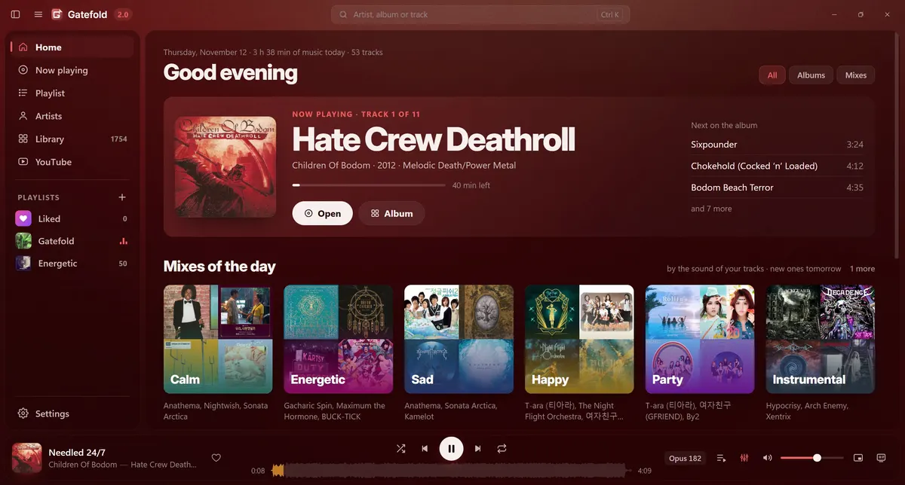
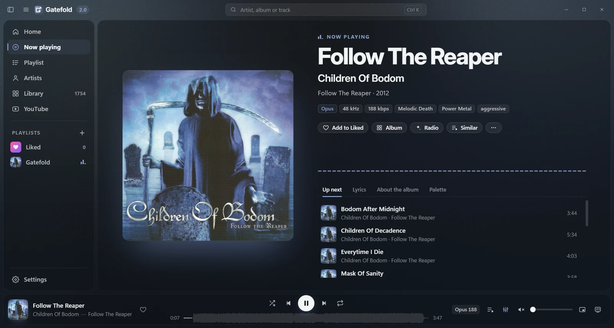
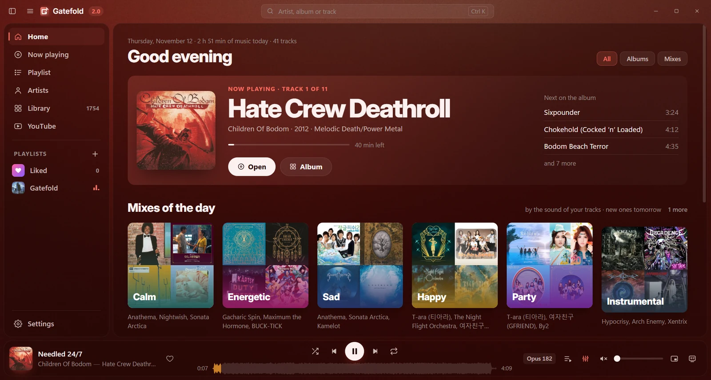
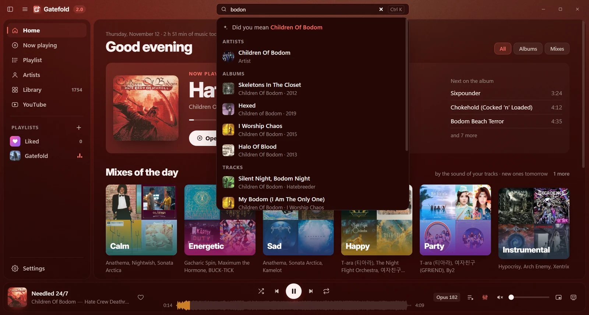
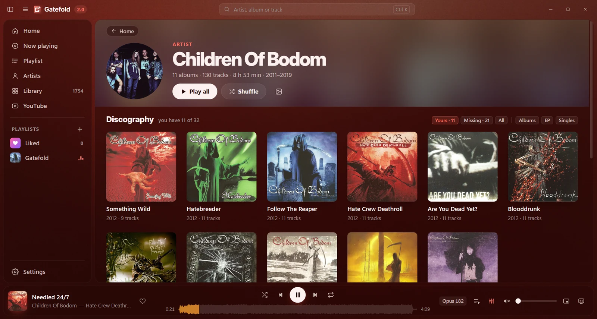
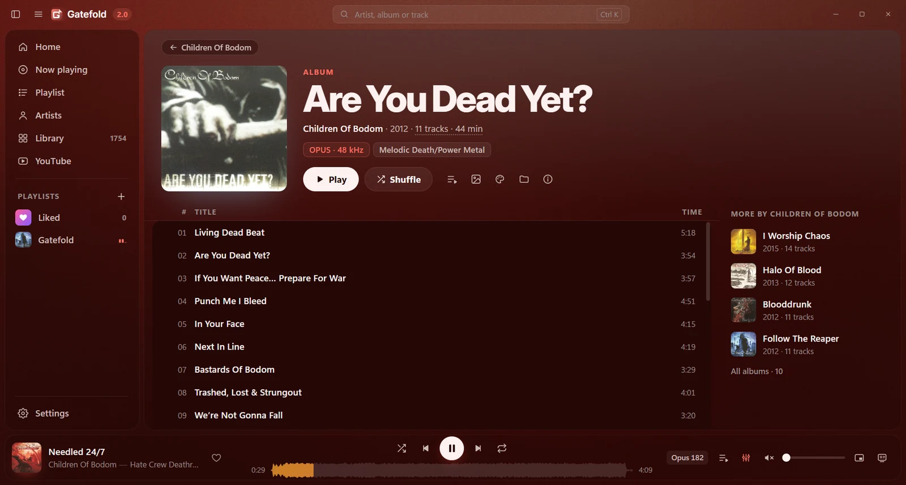
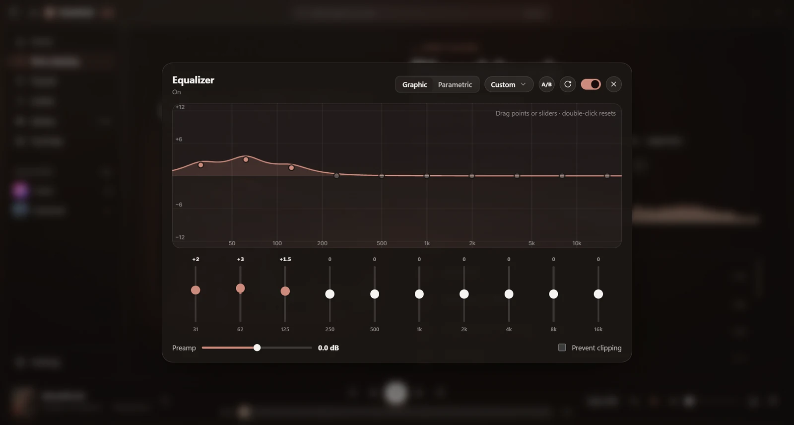
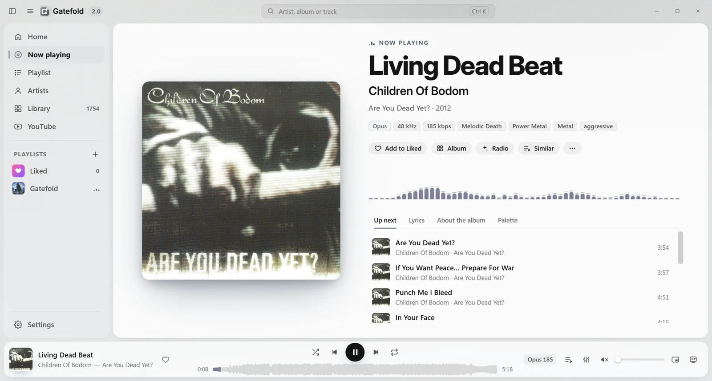
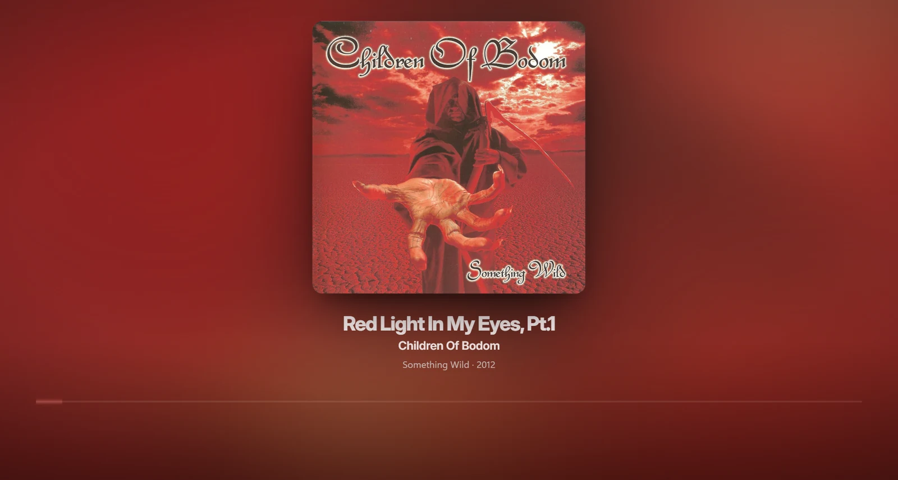

  

<h1 align="center">Gatefold</h1>

Современный интерфейс для foobar2000, который принимает цвета играющего альбома.

  
  
  
  
  

  

  <a href="#-главное">Главное</a> · <a href="#-установка">Установка</a> · <a href="#-вопросы-и-ответы">Вопросы и ответы</a> · <a href="README.md">Read in English</a>

 

  

▶ Нажмите, чтобы открыть видео целиком

## ✨ Главное

- Отдельный компонент foobar2000
- Интерфейс принимает цвета играющего альбома
- Полные дискографии исполнителей
- Любой альбом можно включить через YouTube
- Умный поиск, прощающий опечатки
- Встроенный графический и параметрический эквалайзер
- Выравнивание громкости по EBU R128
- Синхронные тексты песен
- Миксы дня по звучанию вашей музыки
- Умные плейлисты без языка запросов
- История прослушиваний и «Ваш год в музыке»
- Тёмная и светлая темы
- Полный экран, мини-плеер, трей и кнопки на панели задач
- Русский, English, Deutsch, Español, 中文
- Открывается меньше чем за секунду, почти не нагружает процессор
- Бесплатно, без аккаунта и телеметрии

## 🖼 Скриншоты

<table>
<tr>
<td width="50%">
<b>Сейчас играет</b>
</td>
<td width="50%">
<b>Главная</b>
</td>
</tr>
<tr>
<td width="50%">
<b>Поиск</b>
</td>
<td width="50%">
<b>Исполнитель</b>
</td>
</tr>
<tr>
<td width="50%">
<b>Альбом</b>
</td>
<td width="50%">
<b>Эквалайзер</b>
</td>
</tr>
<tr>
<td width="50%">
<b>Светлая тема</b>
</td>
<td width="50%">
<b>Полный экран</b>
</td>
</tr>
</table>

## 📥 Установка

1. Скачайте файл `foo_gatefold` (`.fb2k-component`) из [последнего релиза](../../releases/latest).
2. Откройте его: foobar2000 установит компонент и перезапустится.
3. Выберите **Gatefold**, когда foobar2000 предложит новый интерфейс.

**С Gatefold 1.x:** нажмите в нём **«Обновить сейчас»**, затем **«Установить Gatefold 2.0»**.

<b>Требования</b>

| | |
|---|---|
| Windows | 10 или 11, 64 бита |
| foobar2000 | 2.x, 64 бита |
| WebView2 Runtime | встроен в Windows 11; в Windows 10 приходит с Microsoft Edge |
| Необязательно | `foo_playcount` (статистика прослушиваний), `foo_dr_meter` (значок DR) |

<b>Приватность</b>: без телеметрии и аккаунтов

Каждый сетевой запрос относится к функции, которую видно и можно выключить, и все они идут через foobar2000.

| Функция | Куда | Когда |
|---|---|---|
| Обложки | iTunes, Deezer, MusicBrainz / Cover Art Archive | Альбомы без обложки (можно выключить) |
| Фото и биографии исполнителей | Deezer, MusicBrainz, Wikidata, Википедия | Экран «Исполнители» (можно выключить) |
| Дискографии | MusicBrainz, при необходимости Deezer и Apple Music | Страница исполнителя (можно выключить) |
| Радио и «Похожие» | Deezer, MusicBrainz, ListenBrainz | Только когда вы их включаете |
| Тексты песен | LRCLIB | Треки без текста в тегах или файлах |
| YouTube | youtube-nocookie.com | Только на экране YouTube |
| Обновления | api.github.com, github.com | Раз в 12 часов (можно выключить) |
| Анализ звука | этот репозиторий | Один раз, при включении. Сам анализ не покидает ваш компьютер |

**Необязательные неофициальные источники, по умолчанию выключены:** тексты из Musixmatch, NetEase, QQ Music и Kugou, а также поиск YouTube без ключа. Они используют закрытые интерфейсы, могут перестать работать в любой момент и могут нарушать условия этих сервисов. Тексты и обложки — только для личного использования.

<b>Сочетания клавиш</b>

| Клавиши | Действие |
|---|---|
| Пробел | Играть / пауза |
| ← / → | Перемотка ±5 с (Ctrl: ±30 с) |
| Shift + ← / → | Предыдущий / следующий трек |
| ↑ / ↓ · M | Громкость ±5 · без звука |
| Ctrl+K | Поиск по всему: экраны, команды, альбомы, исполнители, треки |
| L | Нравится |
| Alt+1…8 | Переключение экранов |
| F11 · F | Полный экран · Canvas |
| Ctrl+P | Настройки foobar2000 |

В списках: Shift/Ctrl+щелчок, Ctrl+A, Delete, Ctrl+Z / Ctrl+Y, Alt+↑/↓, Enter, Esc.

## ❓ Вопросы и ответы

<b>Меняет ли он звучание музыки?</b>

Нет. Воспроизведение — самого foobar2000; эквалайзер и выравнивание выключены, пока вы их не включите.

<b>Сохранятся ли плейлисты и компоненты?</b>

Да. Gatefold — ещё один модуль интерфейса; вернуться на Default UI или Columns UI можно в любой момент.

<b>Нужен ли ещё foo_ui_webview2?</b>

Нет.

<b>Это бесплатно? Открытый ли код?</b>

Бесплатно. С версии 2.0 код закрыт: см. [Лицензию](#-лицензия).

## 📄 Лицензия

Gatefold 2.0 **бесплатен, но это не открытое ПО**: © 2026 DEVIROYrus, все права защищены, по [лицензионному соглашению Gatefold](EULA.ru.md) (основной текст — [на английском](EULA.md)). Можно устанавливать, пользоваться и передавать неизменённый официальный пакет; нельзя изменять, брать код или дизайн, продавать. Gatefold 1.x — исходный код в этом репозитории — остаётся под [лицензией MIT](LICENSE). Сторонние компоненты — под своими лицензиями ([THIRD_PARTY_NOTICES.md](THIRD_PARTY_NOTICES.md)).

foobar2000 — бесплатная программа Петра Павловского. Gatefold — независимый проект, не связанный с foobar2000. Обложки альбомов на снимках принадлежат их правообладателям.

  Для тех, у кого всё ещё есть своя музыкальная коллекция.

