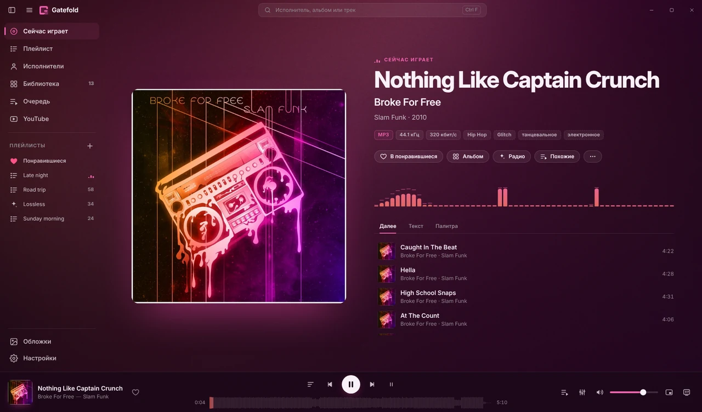

<h1 align="center">Gatefold</h1>

<b>Современный интерфейс для foobar2000, который берёт цвета из вашей музыки.</b> 
<a href="../../releases/latest"><b>Скачать установщик</b></a> · <a href="README.md">English version</a>

Gatefold — тема для компонента [foo_ui_webview2](https://github.com/NereaFantasia/foo_ui_webview2). Она превращает foobar2000 в плеер на всё окно, палитра которого на лету строится из обложки играющего альбома: медиатека, исполнители, плейлисты, синхронный текст, полноэкранный «Холст», YouTube и (по желанию) анализ звука прямо на компьютере. Установщик всё настраивает сам: запустите его — и foobar2000 откроется в Gatefold.

| Плейлист с обложками | Медиатека по цвету обложек |
|---|---|
|  |  |
| **Умные плейлисты** | **Постоянная светлая тема** |
|  |  |

На скриншотах — условные обложки из тестовых данных, а не настоящие альбомы.

## Возможности

**Вид и прослушивание**
- **Цвета из альбома** — роли цветов подбираются из каждой обложки (k-means в OKLab, контраст по WCAG). Или постоянная **Тёмная**, **Светлая** или **Серая** тема; размер текста 13–20 px; анимации на частоте вашего монитора.
- **«Сейчас играет»** — крупная обложка «дышит» под бас, спектр в цветах альбома, бейджи формата (кодек, разрядность и частота, битрейт, DR, ReplayGain, число прослушиваний), синхронный текст и «Далее».
- **Холст** — полноэкранный «Сейчас играет» с медленным движением, текстом и часами; открывается и на втором мониторе.
- **Синхронный текст** из тегов, `.lrc` рядом с треком или LRCLIB; щелчок по строке перематывает, `[` `]` сдвигают тайминг.

**Ваша музыка**
- **Плейлисты в четырёх видах** (по альбомам, с обложками, плитками, компактно) с настоящим редактированием: выделение с Shift/Ctrl, перетаскивание внутри и на плейлист в боковой панели, Delete, Ctrl+Z, Alt+↑/↓.
- **Медиатека и исполнители** — сетки обложек, страницы альбомов, фото исполнителей; альбомы, разбитые гостевыми исполнителями, склеиваются обратно. **Стена по цветам** сортирует медиатеку по цвету обложек и оставляет один из двенадцати подписанных цветов.
- **Умные плейлисты без языка запросов** — недавно добавленные, самое любимое, забытые любимцы, ни разу не слушал, жанр, десятилетие, без потерь, Hi-Res, длинные треки или свой запрос; до создания видно, сколько треков подходит, и несколько примеров. Пополняются сами.
- **Радио «Похожее на это»** — похожие исполнители, которые у вас есть, и каждый трек-кандидат проверяется по звучанию, чтобы настроение держалось; пропущенные исполнители звучат реже.
- **«Понравившиеся»** — сердечко в плеере и в каждой строке, хранятся в обычном плейлисте foobar2000.
- **Обложки** — поиск недостающих (iTunes · Deezer · MusicBrainz/CAA), проверка качества имеющихся и замена слабых (с резервной копией).

**Анализ звука нейросетью (по желанию)**
- Нейросеть Discogs-EffNet один раз слушает каждый трек медиатеки — у вас на компьютере, в фоне, с выбранной скоростью (от «Бережно» до «Максимум»). Результаты не покидают компьютер.
- С ней радио и «Похожие треки» подбирают песни по тому, как они *звучат*; в умных плейлистах появляются настроения — спокойное, энергичное, грустное, радостное, для вечеринки, инструментальное (совсем без голоса), акустическое — и жанры по звучанию; на «Сейчас играет» видны жанры трека (голоса MusicBrainz, упорядоченные по звучанию) и настроение.
- Модели (~30 МБ, CC BY-NC-SA 4.0, только некоммерческое использование) скачиваются, только когда вы включите это в Настройках → Анализ звука (ИИ).

**Вокруг окна**
- ⏮ ⏯ ⏭ ♡ в миниатюре на панели задач, прогресс на значке, по желанию значок в трее с меню плеера и **мини-плеер** поверх всех окон.
- **YouTube** — по ссылке или поиск со своим ключом YouTube Data API; своя панель управления, качество, очередь, история и мини-плеер. Музыка встаёт на паузу, пока идёт видео.
- **Ваш foobar2000 остаётся вашим** — правый щелчок открывает родное контекстное меню, ☰ — полное главное меню, все компоненты на месте. В Настройки → foobar2000 есть вывод звука, ReplayGain, DSP и всё дерево Advanced.
- **Русский и английский** — язык берётся из Windows или задаётся в настройках.
- **Обновление в один щелчок** из релизов этого репозитория, с проверкой контрольной суммы и «Вернуть предыдущую версию».
- **Режим приколов** (секрет: 10 щелчков по надписи «Gatefold») — три стиля интерфейса и 45 достижений.

## Требования

| | |
|---|---|
| Windows | 10 или 11, 64-бит |
| foobar2000 | 2.x, 64-бит |
| [foo_ui_webview2](https://github.com/NereaFantasia/foo_ui_webview2) | 2.0 или новее |
| WebView2 Runtime | Предустановлен в Windows 11 и на большинстве Windows 10 |
| Необязательно | `foo_playcount` (статистика, сортировка «недавно проигранные»), `foo_dr_meter` (бейдж DR) |

## Установка

### Установщиком (рекомендуется)
Скачайте `Gatefold-Setup.exe` из [Releases](../../releases) и запустите. При необходимости он установит или обновит foobar2000, foo_ui_webview2 и WebView2 Runtime положит тему на место, добавит ярлыки Gatefold и сделает Webview2 UI интерфейсом foobar2000 — он сразу откроется в Gatefold (настройки сохраняются в `config.sqlite.before-gatefold`; вернуться — *Default User Interface* в Preferences → Display).

### Вручную
1. Установите **foo_ui_webview2**: откройте файл `.fb2k-component`, подтвердите установку в foobar2000 и перезапустите его.
2. **File → Preferences → Display → WebView2 UI** → **Manage… → Create…**, имя шаблона `gatefold`. Нажмите **Open…**.
3. Скопируйте в открывшуюся папку **содержимое** архива так, чтобы `index.html` лежал прямо в ней.
4. В **Preferences → Display** выберите интерфейс **Webview2 UI**, в поле **Template** — `gatefold`, затем **Apply**.

Чтобы вернуться, снова выберите *Default User Interface* — прежняя раскладка сохранится.

### Обновление
Когда выходит новый релиз, внизу боковой панели (и в **Настройки → Обновления**) появляется кнопка **Доступно обновление**. Один щелчок показывает, что изменилось, и устанавливает: архив темы скачивается из Releases этого репозитория, сверяется с `SHA256SUMS.txt`, текущая версия сохраняется в `%profile%\gatefold\backup\<версия>`, интерфейс перезапускается. Кнопка **Вернуть предыдущую версию** в настройках возвращает резервную копию. Если релизу нужен более новый foo_ui_webview2, вместо обновления предлагается установщик — он обновит всё сразу. Проверку можно выключить; без вашего щелчка ничего не устанавливается.

## Конфиденциальность

В Gatefold **нет телеметрии** и аккаунтов. Тема делает только те запросы, которые нужны её функциям, и все они идут через foobar2000:

| Функция | Куда | Когда |
|---|---|---|
| Обложки | iTunes Search API, Deezer API, MusicBrainz / Cover Art Archive | Для альбомов без обложки (автопоиск можно выключить) |
| Фото исполнителей | Deezer, MusicBrainz / Wikidata | Экран «Исполнители» (можно выключить) |
| Радио «Похожее на это» | Deezer (похожие исполнители, по имени) | Только когда вы запускаете радио |
| Тексты | LRCLIB | Для треков без текста в тегах и файлах |
| YouTube | плеер youtube-nocookie.com; Google API — если указан ваш ключ | Только на экране YouTube |
| Проверка обновлений | api.github.com, github.com (загрузка релиза) | Раз в 12 часов и по кнопке «Проверить» (можно выключить) |
| Анализ звука (ИИ) | raw.githubusercontent.com (ветка `ml-assets` этого репозитория) | Один раз, когда вы включаете функцию; потом проверка манифеста не чаще раза в неделю. Сам анализ не покидает ваш компьютер |
| Жанры (при включённом анализе звука) | musicbrainz.org (имя исполнителя, затем его альбомы) | Один раз на исполнителя, примерно запрос в секунду в фоне (можно выключить) |

Всё скачанное хранится у вас на компьютере: в кэше темы или рядом с музыкой, если вы сами выбрали сохранять туда обложки и тексты.

### Неофициальные источники — по умолчанию выключены
В настройках можно включить тексты из **Musixmatch, NetEase, QQ Музыки и Kugou** и **поиск YouTube разбором страницы** без ключа. Они работают через закрытые интерфейсы сервисов без их разрешения: могут перестать работать в любой момент, а их использование может нарушать условия этих сервисов. Пока вы сами их не включите, они не работают. Тексты песен и обложки защищены авторским правом и годятся только для личного использования.

## Подпись кода

Free code signing provided by [SignPath.io](https://about.signpath.io/), certificate by [SignPath Foundation](https://signpath.org/) — бесплатная подпись кода для открытых проектов.

- Коммиттеры и ревьюеры — участники этого репозитория, утверждает выпуск владелец репозитория.
- Каждый подписанный релиз собирается GitHub Actions из этого репозитория (`.github/workflows/release.yml`) и утверждается вручную перед подписью.
- Приватность: программа не передаёт никаких данных в другие сетевые системы, если об этом специально не попросил пользователь или тот, кто её устанавливает или запускает, — все запросы перечислены в разделе «Приватность».

## Горячие клавиши

| Клавиши | Действие |
|---|---|
| Пробел | Воспроизведение / пауза |
| ← / → | Перемотка ±5 с (с Ctrl — ±30 с) |
| Shift + ← / → | Предыдущий / следующий трек |
| ↑ / ↓ | Громкость ±5 |
| M | Без звука |
| L | В понравившиеся / убрать |
| Ctrl+F | Поиск |
| Alt+1…8 | Сейчас играет / Плейлист / Исполнители / Медиатека / Очередь / Обложки / Настройки / YouTube |
| Alt+← / Alt+→, кнопки мыши 4/5 | Назад / вперёд |
| F11 | Полный экран |
| F (на «Сейчас играет») | Холст |
| Ctrl+R | Перезагрузить интерфейс |
| Ctrl+P | Настройки foobar2000 |

В плейлисте: Shift/Ctrl+щелчок — выделение · Ctrl+A — всё · Delete — удалить · Ctrl+Z / Ctrl+Y — отменить / вернуть · Alt+↑/↓ — переместить · Enter — играть · Esc — снять выделение.

На экране YouTube: Пробел/K — пауза · J/L — ±10 с · F — полный экран · T — кинотеатр · Q — качество · N/P — следующее/предыдущее · `/` — поиск.

## Если что-то не так

- **foobar2000 открывается в старом интерфейсе** — выберите **Webview2 UI** в Preferences → Display (установщик делает это сам; это для ручной установки или если он не смог этого сделать).
- **Белая или тестовая страница** — не выбран шаблон, или `index.html` лежит не прямо в папке шаблона.
- **Обложки не скачиваются** — посмотрите «Последнюю ошибку» на экране «Обложки». В View → Console есть строки `[Gatefold]`. Если папка с музыкой только для чтения, сохранить обложку некуда.
- **Странности с окном** — Настройки → Окно и запуск → выключите «Собственную рамку окна» и нажмите Ctrl+R.
- **Отладка** — Preferences → WebView2 UI → включите DevTools, затем нажмите F12.

В сообщении об ошибке укажите версии foobar2000 и foo_ui_webview2 и приложите строки `[Gatefold]` из консоли.

История версий до публикации — в [docs/HISTORY.ru.md](docs/HISTORY.ru.md).

## Перевод

В исходниках строки написаны по-русски и обёрнуты в `$t('…')`. Каждый язык — это файл в `js/locales/`, который сопоставляет русской строке её перевод (как в gettext). Множественные числа записываются как `'one|other'` и выбираются по правилам CLDR (`Intl.PluralRules`). Статичная разметка `index.html` переводится при запуске. Чтобы добавить язык, скопируйте `js/locales/en.js`, переведите значения и зарегистрируйте язык в `js/i18n.js`.

## Лицензия

[MIT](LICENSE) © участники проекта Gatefold. У сторонних шрифтов и компонентов свои лицензии — см. [THIRD_PARTY_NOTICES.md](THIRD_PARTY_NOTICES.md).
foobar2000 — бесплатная программа Петра Павловского. Gatefold — независимый проект, не связанный с foobar2000 и автором foo_ui_webview2 и не одобренный ими.
