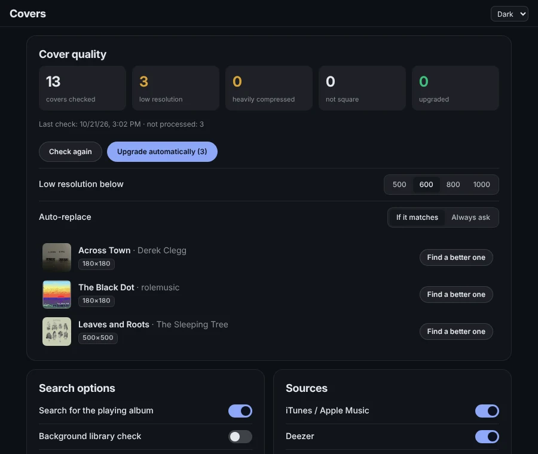

# Gatefold panels for Default UI and Columns UI

Two small add-ons for people who like their foobar2000 layout as it is. Each is a panel for **Default UI** or **Columns UI**: you don't need the Gatefold interface for them, only the [foo_ui_webview2](https://github.com/NereaFantasia/foo_ui_webview2) component.

**[Download the panels](https://github.com/DEVIROYrus/gatefold-foobar2000/releases/tag/panels-v1.0.0)**

## Gatefold Seekbar

A waveform seekbar in the colours of the album that is playing.

- **Looks:** bars, a solid waveform or a plain line.
- **Colours:** taken from the cover, or fixed dark, light or grey.
- **Background:** coloured or transparent, so it blends into your layout.
- **Time:** elapsed / total, remaining, or none. The cover can be shown on the left.
- **Controls:** click or drag to seek. The mouse wheel steps 5 s (30 s with Shift). Middle-click plays or pauses. ← / → seek when the bar has focus.
- **Speed:** the waveform comes from foo_ui_webview2 and is cached by it. An idle panel draws nothing.

Right-click the bar for its options.

## Gatefold Covers

Gatefold's cover finder on its own.

- **Finds missing covers** for the whole library and for the album that starts playing. Sources: iTunes, Deezer, MusicBrainz / Cover Art Archive.
- **Upgrades weak covers.** It finds covers that are too small, heavily compressed or not square, and replaces them with a bigger version of the same picture. The old file is backed up, and any replacement can be undone.
- **Saves as foobar2000 expects:** `cover.jpg` next to the tracks. In folders shared by several albums it embeds the cover into that album's tracks instead.
- **Asks when unsure:** matches it isn't sure about wait for your click.

## Install

1. You need foobar2000 2.x (64-bit) and **foo_ui_webview2** 2.0 or later. Installing Gatefold sets that up, or get the component from [its releases](https://github.com/NereaFantasia/foo_ui_webview2/releases).
2. Unzip `gatefold-seekbar-<version>.zip` and/or `gatefold-covers-<version>.zip` into `<profile>\webview-ui\`. The profile is usually `%APPDATA%\foobar2000-v2`, or the `profile` folder of a portable install. You should end up with `webview-ui\gatefold-seekbar\index.html`.
3. Add a panel:
   - **Columns UI:** *File → Preferences → Display → Columns UI → Layout*, insert **WebView2 Panel**.
   - **Default UI:** *View → Layout → Enable layout editing mode*, right-click where it should go, then *Add New UI Element* → **WebView2 Panel**.
4. Right-click the panel → *Configure* → **Template**: `gatefold-seekbar` or `gatefold-covers`.

To update, unzip the new version over the old one.

## Privacy

- **Gatefold Seekbar** makes no network requests.
- **Gatefold Covers** contacts iTunes, Deezer and MusicBrainz / Cover Art Archive to find covers. Each source can be switched off in the panel. There is no telemetry.

## License

MIT, like Gatefold. The panels contain a few of Gatefold's own modules, unchanged (the bridge to foobar2000, the cover finder, the colour maths). They are built from this folder by `panels/build.py`.
