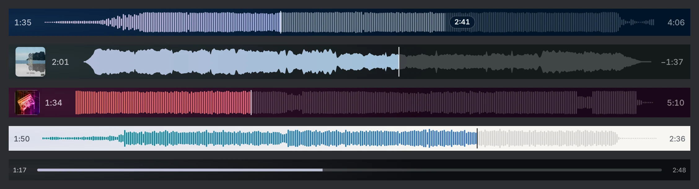

# Gatefold Seekbar

A waveform seekbar for foobar2000 in the colours of the album that is playing. It is a panel for **Default UI** and **Columns UI**: you don't need the Gatefold interface, only the [foo_ui_webview2](https://github.com/NereaFantasia/foo_ui_webview2) component.

**[Download gatefold-seekbar-1.0.1.zip](https://github.com/DEVIROYrus/gatefold-foobar2000/releases/download/panels-v1.0.1/gatefold-seekbar-1.0.1.zip)** · [release page](https://github.com/DEVIROYrus/gatefold-foobar2000/releases/tag/panels-v1.0.1)

- **Looks:** bars, a solid waveform or a plain line.
- **Colours:** taken from the cover, or fixed dark, light or grey.
- **Background:** coloured or transparent, so it blends into your layout.
- **Time:** elapsed / total, remaining, or none. The cover can be shown on the left.
- **Controls:** click or drag to seek. The mouse wheel steps 5 s (30 s with Shift). Middle-click plays or pauses. ← / → seek when the bar has focus.
- **Speed:** the waveform comes from foo_ui_webview2 and is cached by it. An idle panel draws nothing. It follows foobar2000's precise playback position, about ten times a second.

Right-click the bar for its options. Unlike Waveform Minibar it is a WebView2 panel, not a native component, so it uses somewhat more memory.

## Install

1. You need foobar2000 2.x (64-bit) and **foo_ui_webview2** 2.0 or later ([its releases](https://github.com/NereaFantasia/foo_ui_webview2/releases)).
2. Unzip `gatefold-seekbar-<version>.zip` into `<profile>\webview-ui\`. The profile is usually `%APPDATA%\foobar2000-v2`, or the `profile` folder of a portable install. You should end up with `webview-ui\gatefold-seekbar\index.html`.
3. Add a panel:
   - **Columns UI:** *File → Preferences → Display → Columns UI → Layout*, insert **WebView2 Panel**.
   - **Default UI:** *View → Layout → Enable layout editing mode*, right-click where it should go, then *Add New UI Element* → **WebView2 Panel**.
4. Right-click the panel → *Configure* → **Template**: `gatefold-seekbar`.

To update, unzip the new version over the old one.

**Privacy:** the seekbar makes no network requests.

MIT, like [Gatefold](../../README.md). The other panel: [Gatefold Covers](../covers/README.md).
